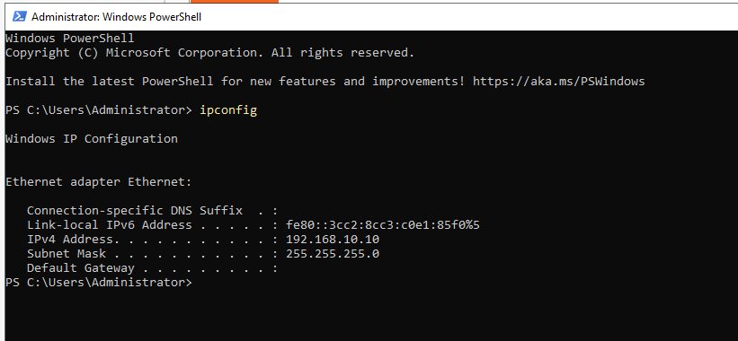
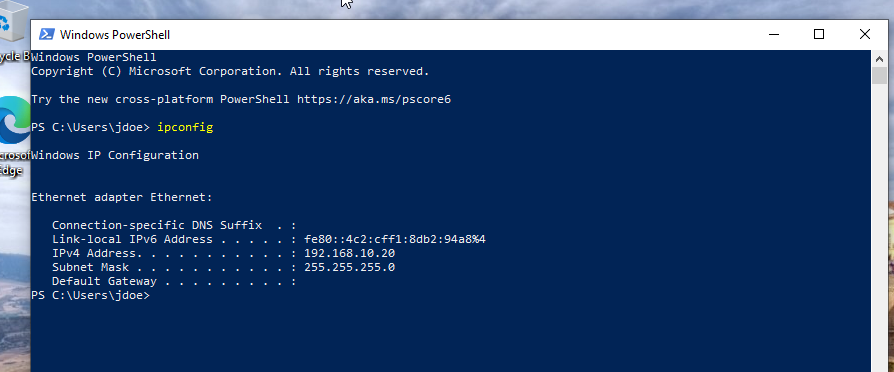
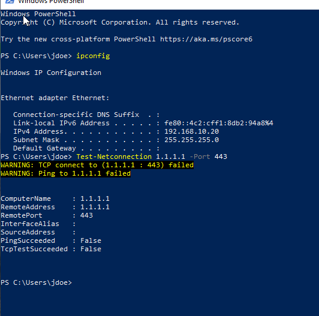

# CR-003 — Add pfSense gateway to the lab network

| Field            | Value |
|------------------|-------|
| Requested by     | J. Saraza (IT) |
| Implemented by   | J. Saraza |
| Approved by      | Self (lab). In production: <!-- hint: who signs off on a network change that removes isolation? --> |
| Date / window    | <!-- date and time you start --> |
| Change type      | Normal |
| Risk             | Medium <!-- hint: one line on why. What could reach the DC after this that couldn't before? --> |
| Systems affected | New VM: pfSense. AD-DC01 and AD-CL01: default gateway added. AD-DC01: DNS forwarder added |
| Users affected   | None directly; all domain machines gain a controlled route out |

## Reason for change
<!-- hint: what does the lab lack that a real network has? Name two things this enables
(e.g. patching the DC, sending logs to the SIEM) and why a firewall, not a direct
connection, is the right way to do it. -->

## Current state (before), with evidence
The lab is isolated: no default gateway on either machine.

`ipconfig` on AD-DC01 and AD-CL01 — Default Gateway is blank:

`Test-NetConnection 1.1.1.1 -Port 443` on AD-CL01 fails:

## Implementation steps
1. Confirm snapshots `pre-P3` exist for AD-DC01 and AD-CL01.
2. Create the pfSense VM: 1 vCPU, 1 GB RAM, 8 GB disk. Adapter 1 Bridged (WAN), Adapter 2 Internal Network `adlab-net` (LAN).
3. Install pfSense: WAN = em0 (DHCP), LAN = em1, static 192.168.10.1/24, LAN DHCP server off.
4. Snapshot the pfSense VM: `pfsense-installed`.
5. AD-DC01 and AD-CL01: set default gateway to 192.168.10.1.
6. AD-DC01: DNS Manager → server → Properties → Forwarders → add 1.1.1.1.
7. pfSense LAN rules, top to bottom: allow DNS (53) and HTTPS (443) out; block everything else with logging on. (The rule for logs to Splunk, TCP 9997, is added in Phase 3.)

## Backout plan
Rollback trigger: <!-- hint: what would you see that means "undo this"? e.g. sign-in or S: drive broken, DC unreachable from CL01 -->

Steps:
1. Remove the default gateway from AD-DC01 and AD-CL01.
2. Remove the DNS forwarder on AD-DC01.
3. Power off the pfSense VM.
4. Only if the above fails: restore `pre-P3` on **both** AD-DC01 and AD-CL01 together.

<!-- hint: in your own words, why restore both VMs together rather than just the DC?
(Think about Thursday's Q2 and the computer account password.) -->

## Verification
From AD-CL01:
1. `Resolve-DnsName microsoft.com` — returns addresses (DNS forwarder works).
2. `Test-NetConnection 1.1.1.1 -Port 443` — TcpTestSucceeded: True (allowed rule works).
3. `Test-NetConnection 1.1.1.1 -Port 3389` — fails, and the block appears in pfSense's firewall log (default deny works and is logged).
4. Sign in as agarcia — S: drive maps and opens (nothing broke for users).

<!-- screenshots for each, in screenshots/phase1/ -->

**Result:** <!-- after the change: what happened, in your words -->

## Outcome
<!-- after the change: "Completed." plus what the lab can do now that it couldn't before,
and what happens to the pre-P3 snapshots. -->
